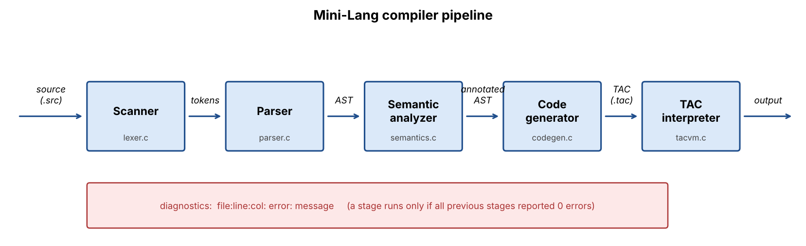

# Mini-Lang Compiler

A complete compiler written in C for a small imperative language (`int`/`bool`, arithmetic,
relational and logical expressions, `if`/`else`, `while`, `print`, `read`). It translates
`.src` programs into **Three-Address Code** (`.tac`) and includes an interpreter that runs it.

```
Source (.src) -> Scanner -> Parser -> Semantic analysis -> TAC generation -> TAC interpreter
```



## Build and run

Requirements: `gcc` (C11) and `make`.

```sh
make                                   # builds bin/compile and bin/run
bin/compile examples/hello.src -o out.tac
bin/run out.tac                        # read() takes integers from stdin, or use -i file

make test                              # runs the whole test suite
```

Equivalent wrappers: `scripts/compile.sh input.src -o out.tac`, `scripts/run.sh out.tac`.

Useful options of `compile`: `--dump-tokens` (stop after the scanner) and `--dump-ast`
(stop after the parser). `run` accepts `--max-steps N` (default 50,000,000) to stop
runaway loops.

## Language in one example

```c
int n, f;
read(n);
f = 1;
while (n > 1) { f = f * n; n = n - 1; }
print(f);
```

The full definition (lexical rules, grammar, typing rules, TAC instruction set) is in
[`docs/language-spec.md`](docs/language-spec.md).

## Project layout

```
src/common.[ch]           diagnostics (file:line:col: error: ...) and the Type enum
src/lexer/                scanner: characters -> tokens
src/parser/               recursive-descent parser: tokens -> AST (ast.h, ast.c = AST dump)
src/semantics/            scopes, symbol table, type checking; annotates the AST
src/ir/codegen.c          AST -> TAC
src/runtime/tacvm.[ch]    TAC loader + interpreter
src/main_compile.c        CLI: compile
src/main_run.c            CLI: run
tests/                    *.src, *.in, *.out / *.err and run_tests.sh
docs/                     language-spec.md, design-diagram.png
scripts/                  compile.sh, run.sh
```

## Pipeline interfaces and invariants

| Stage | Input | Output | Errors |
|-------|-------|--------|--------|
| Scanner | source text | `Token` stream (`type`, `text`, `value`, `line`, `col`) via `lexer_next()`; `TK_EOF` forever at the end | bad character, unterminated comment, huge literal; reported and skipped |
| Parser | token stream | AST (`Stmt`/`Expr` nodes) | first syntax error: `unexpected X, expected Y`; parsing stops |
| Semantic analyzer | AST | same AST annotated with `Expr.type`, `Expr.sym`, `Stmt.sym` + symbol table (`sem_symbols`) | all semantic errors are collected, none stops the analysis |
| Code generator | annotated AST | text `.tac` | none (input is guaranteed valid) |
| TAC interpreter | `.tac` file | program output | malformed instruction, undefined label, division by zero, step limit, missing input |

Invariants:

1. `main_compile` runs a stage only if all previous stages reported **zero** errors
   (exit code 1 otherwise).
2. After semantic analysis every `EX_VAR`/`ST_ASSIGN`/`ST_READ` points to a declared symbol,
   and every expression has a type different from `T_ERR`. The code generator relies on this.
3. Every symbol has a unique storage name, so shadowed variables and user variables named
   like temporaries (`t1`) never collide in the TAC.
4. Booleans are `0`/`1` in TAC; `&&`/`||` are compiled to jumps (short-circuit).

## Trace of a sample program

Source (`sample.src`):

```c
int x, y, z;
x = 1;
y = 2;
if (x < y) { z = 1; } else { z = 0; }
```

**1. Scanner** (`compile sample.src --dump-tokens`, first lines; `line:col  class  lexeme`):

```
1:1   KEYWORD  int
1:5   ID       x
1:6   SYMBOL   ,
1:8   ID       y
...
2:1   ID       x
2:3   SYMBOL   =
2:5   NUM      1
2:6   SYMBOL   ;
```

**2. Parser** (`--dump-ast`):

```
Program
  Decl int x
  Decl int y
  Decl int z
  Assign x
    Num 1
  Assign y
    Num 2
  If
    Binary <
      Var x
      Var y
    then:
      Block
        Assign z
          Num 1
    else:
      Block
        Assign z
          Num 0
```

**3. Semantic analysis**: the block scopes are pushed/popped, `x`, `y`, `z` are `int`,
`x < y` has type `bool` (valid `if` condition), assignments type-check. The symbol table is
`x:int, y:int, z:int`, all at global scope.

**4. Code generation** (`compile sample.src`):

```
    x := 1
    y := 2
    if x < y goto L1
    z := 0
    goto L2
L1:
    z := 1
L2:
    halt
```

Other examples produced by the compiler (`x = a + 3;`):

```
    t1 := a + 3
    x := t1
```

**5. Execution**: the interpreter resolves `L1` → instruction 5 and `L2` → 7, starts at
`pc = 0` with all variables at 0, and executes until `halt`.

## Error messages

```
$ bin/compile tests/err_undeclared.src
tests/err_undeclared.src:2:5: error: use of undeclared variable 'x'
1 error(s); compilation aborted
```

## Testing

`tests/run_tests.sh` (also `make test`) runs three kinds of tests:

* `ok_*.src` – compile and run; stdout must match `ok_*.out` (stdin from `ok_*.in` if present).
  They cover precedence, short-circuit logic, if/else, loops, scopes/shadowing, `read`,
  comments, and a variable named `t1` (clash with temporaries).
* `err_*.src` – compilation must fail with the message in `err_*.err` (lexical, syntax and
  semantic errors).
* `rt_*.src` – run-time errors (division by zero).

## Limitations

Integers only (32-bit), no functions, no arrays. The parser stops at the first syntax
error. Memory of the AST is not freed because the compiler is a short-lived process.
